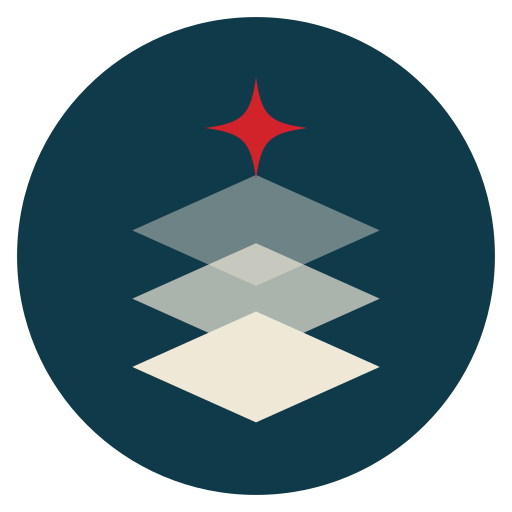

# BASIS
<strong>Build AI Services In Sovereign infrastructure</strong>

<p align="center">
  
</p>

BASIS is a Platform as a Service on Kubernetes for building generative AI services on sovereign
infrastructure: everything runs in Kubernetes clusters you own, in your own data centers or
regions. Teams order the building blocks of an AI service themselves, through a Kubernetes API or
a developer portal, and the platform runs and operates them. It is built on
[Crossplane](https://www.crossplane.io/) and [Backstage](https://backstage.io/).

The platform currently provides these building blocks:

| Layer | Component |
|---|---|
| Context / RAG | PostgreSQL on [CloudNativePG](https://cloudnative-pg.io/) (CNPG) with [pgvector](https://github.com/pgvector/pgvector), VectorChord and pg_search |
| Cache | Exact and semantic caches on [Valkey](https://valkey.io/), run by the [valkey-io operator](https://github.com/valkey-io/valkey-operator), with valkey-search for vector (KNN) lookups |
| Observability | [Prometheus](https://prometheus.io/) and [Grafana](https://grafana.com/) per Project, with metrics, alerts and dashboards for every database and cache |
| Object storage | A backup bucket per Project, provisioned with [COSI](https://github.com/kubernetes-sigs/container-object-storage-interface) |

What a team gets:

- **Self-service:** one `PostgresCluster` API object, or a form in the Backstage portal, gives a
  team a highly available cluster with connection pooling (PgBouncer), in a size (SKU) from the
  platform's catalog (XS to XL) with PostgreSQL tuned to it, or with custom CPU and memory (see
  [Sizes](api/README.md#sizes)).
- **Vector & RAG:** a `vector` workload profile (PostgreSQL 18) with pgvector, VectorChord for large
  vector indexes and pg_search (BM25) for hybrid search, mounted as CNPG extension images, memory
  tuned for building vector indexes and metrics on them (see [Profiles](api/README.md#profiles)).
- **Caches:** one `ValkeyCache` API object, or a form in the portal, gives a team an exact cache
  (prompt hash, tool, SQL and search results) or a semantic cache (embedding lookups through
  valkey-search, e.g. for LiteLLM) in its Project's protected or recovery location, with a generated password, metrics,
  alerts and a Grafana dashboard in the Project's Grafana, like a PostgresCluster's (see
  [ValkeyCache](api/README.md#the-valkeycache-api)).
- **Extensions:** pgvector for vector search (embeddings, RAG) and other extensions from the
  platform's catalog, picked per cluster in the API or the portal (see
  [Extensions](api/README.md#extensions)).
- **Multi-tenant:** each team works in its own **Project**, with access control, an optional quota
  and deletion protection.
- **Built-in observability:** metrics, alerts and the CNPG Grafana dashboard for every cluster, in
  the Project's own Prometheus and Grafana.
- **Backups and resilience:** continuous backups to object storage, point-in-time restore into a
  new cluster, plus multi-region replicas and disaster recovery (see
  [below](#multi-region-replicas-and-disaster-recovery)).
- **Multi-cluster:** databases run in any number of Kubernetes clusters (**locations**), all
  managed from one control plane.


## Architecture

The platform has three layers. A **control plane** cluster runs the APIs (Crossplane) and the portal
(Backstage), but no databases. The PostgreSQL clusters run in **locations**, which are other
Kubernetes clusters registered with the platform. Teams get a **Project** (a namespace with its own
Prometheus and Grafana) with a **protected** location, where its PostgreSQL clusters run, and
optionally a **recovery** location. With geo replication, a cluster keeps a CNPG replica cluster in
the recovery location, ready to take over. The replica is fed through the project's backup bucket,
which is provisioned with COSI on the control plane and has its own keys for each location.

## Multi-region replicas and disaster recovery

- **Multi-region replicas:** the protected and recovery locations can be clusters in different
  regions or data centers. With geo replication on, every PostgreSQL cluster keeps a CNPG replica
  cluster in the recovery location that continuously replays WAL from the project's backup bucket.
- **Disaster recovery:** set `geoReplication.promotion` on a `PostgresCluster` to move the primary
  to the other location. `Switchover` (the default) is for planned moves: it promotes the replica
  without losing data, and the old primary then follows it as a replica. `Failover` promotes the
  recovery location right away, for when the protected location is down. Turning geo replication
  off switches back to the protected location first, so no writes are lost.
- **Backups:** continuous backups and WAL archiving to the project's object storage bucket with the
  Barman Cloud plugin. The recovery location's replica is fed from this bucket.
- **Restore:** `spec.restore` creates a new `PostgresCluster` from another cluster's backup folder,
  up to a point in time or the latest state, also of a cluster deleted since (the Project keeps an
  inventory of the folders in its bucket). The source is only read; the restored cluster archives to
  a folder of its own. The portal offers it on a cluster's Backups tab and on the project page.
  See [Restore](api/README.md#postgrescluster-restore).

See [Locations](api/README.md#locations) for how to configure this.

| Folder | What | Built with |
|---|---|---|
| [`deps/`](deps/) | cert-manager, Prometheus Operator, grafana-operator, ingress, the Valkey operator; the `demo` Project | Helm, kubectl |
| [`operator/`](operator/) | CloudNativePG operator, Barman Cloud backup plugin and the PostgreSQL image catalog, installed from charts **vendored in this repo** | Helm |
| [`api/`](api/) | `PostgresCluster` (`cnpg.cndev.nl/v1alpha1`): one namespaced API object that bundles everything a production CNPG cluster needs, including metrics, alerts and the CNPG Grafana dashboard. `Project` (`platform.cndev.nl/v1alpha1`): a namespace with its own Prometheus and Grafana, RoleBindings, an optional quota and deletion protection. Both place what runs in the locations through provider-kubernetes. `ValkeyCache` (`cache.cndev.nl/v1alpha1`): an exact or semantic Valkey cache in the Project's location. The PostgresCluster and ValkeyCache compositions are a Go composition function, function-basis ([`api/function/`](api/function/)) | Crossplane v2, Go |
| [`portal/`](portal/) | Portal to create projects, clusters and caches and to inspect them; catalog integration and Software Templates | Backstage (new frontend + backend system) |

## Install

**Every location** (where databases run): cert-manager (for the backup plugin) and the Prometheus
Operator from [`deps/`](deps/README.md), then CloudNativePG:

```sh
KUBECONFIG=dc-a.kubeconfig operator/install.sh   # CNPG 1.30 + barman-cloud plugin + ClusterImageCatalog
```

Locations that run caches also get the Valkey operator ([`deps/`](deps/README.md#5-valkey-operator-locations-with-caches)).

**The control plane**: the Prometheus Operator and grafana-operator from
[`deps/`](deps/README.md) (each Project's Grafana and the Prometheus its locations write to
run here; switch them off per project if you don't want them), then:

```sh
api/install/install.sh                        # Crossplane 2.4 + functions + provider + RBAC + APIs + policies
api/install/add-location.sh dc-a dc-a.kubeconfig   # each location (or add it in the portal)
kubectl apply -f deps/control-plane/project-defaults.yaml   # platform-wide Project settings (edit the ingress domain)
kubectl apply -f deps/demo/project.yaml                  # Project demo (edit its location)
kubectl apply -f api/examples/minimal.yaml    # a PostgresCluster in demo, running in dc-a
```

`install.sh` installs the published composition function, function-basis, from ghcr.io, at the
tag in [`api/install/function-basis.yaml`](api/install/function-basis.yaml). Whenever
`api/function/` changes (a new API it composes, a composition change), publish a new version and
roll it out before applying the APIs that need it:

```sh
make -C api test                                      # unit + render tests
make -C api function-push FUNCTION_VERSION=<version>  # publish to ghcr.io
# set <version> in api/install/function-basis.yaml and the api/Makefile default, commit
api/install/install.sh                                # rolls it out, then the APIs
```

See [function-basis](api/README.md#function-basis) for the details (logging in to ghcr.io, the
package must be public or Crossplane needs a pull secret, rolling back).

See [Locations](api/README.md#locations) for the protected and recovery sites and
geo replication. The portal also runs on the control plane: see
[`portal/README.md`](portal/README.md).

## Test

| Command | Needs | Covers |
|---|---|---|
| `operator/verify.sh` | helm | vendored charts lint and render with the production values |
| `make -C api test` | Go, crossplane CLI, Docker/podman | function-basis's unit tests (the switchover state machine, the guards that refuse to tear down a running database, parameter precedence); every composition renders (PostgresCluster: 22 cases incl. sizes and extensions from their catalogs, geo-replicated, switchover, failover, draining, pinned sites, no Project, the Project's COSI backup bucket, restores from the bucket and from a store of its own; Project: 6 incl. both sites, a COSI bucket with its inventory of backup folders and an unregistered location; Location: 3 incl. the optional Valkey operator; ValkeyCache: 3 incl. semantic and no Project; empty and observed); output, and the manifests inside provider-kubernetes Objects, validated against the real CRD schemas; status/readiness/dashboard/alert/project-wiring/topology assertions |
| `cd portal && yarn tsc && yarn test:all` | node 22 | backend (REST API incl. caches, permissions, catalog provider, scaffolder action) and frontend (forms, list page) |
| `hack/e2e-kind.sh` | kind, helm, Docker/podman, `fs.inotify.max_user_instances` ≥ 512 | a control plane and one location on kind, installed as documented: Project goes Ready in both, a PostgresCluster in it goes Ready in the location (no CNPG on the control plane), `psql` through PgBouncer, the location's Prometheus scrapes it and remote-writes to the project's Prometheus on the control plane, its Grafana has the dashboard, then a ValkeyCache with the Valkey operator in the location: Ready, password required, metrics on both Prometheuses, alerts, its dashboard in Grafana; deletion guardrails hold, deletes cascade |
| `hack/e2e-locations.sh` | kind, helm, Docker/podman, `fs.inotify.max_user_instances` ≥ 512 | a control plane, a protected and a recovery location, MinIO as the shared object store: a Project with both sites, a geo-replicated PostgresCluster, a row written in the protected site shows up in the recovery site, a point-in-time restore into a new cluster stops at the target time and archives to a folder of its own, a switchover promotes it (writes work, the old primary follows), turning geo replication off switches back first and loses nothing, the policy and XRD rules reject what they should |

Both e2e scripts use their own kubeconfigs in `.e2e/` and never touch your current context. They
install function-basis built from the checkout, not the published package.

## TODO

Next steps for the platform.

| Item | What |
|---|---|
| Full generative AI platform | Grow BASIS into the full stack (see [Platform scope](portal/catalog/docs/scope.md)): self-hosted models with vLLM, KServe and llm-d; a router and gateway with the Gateway API Inference Extension and Envoy AI Gateway or agentgateway; llm-d prefix-cache-aware routing (the exact and semantic cache on Valkey is there: `ValkeyCache`); guardrails; OpenTelemetry traces next to Prometheus and Grafana; orchestration with LangGraph. Each as a self-service API object per Project, like `PostgresCluster` |
| Automatic major upgrades | Opt-in in-place `pg_upgrade` to the next major in a maintenance window: pre-flight checks (health, extensions, recent backup), a fresh base backup afterwards, statistics refreshed; geo-replicated clusters too |
| Self-fencing at each site | Prevents split brain on a failover. Today the site that is cut off is not fenced: it can't receive the update, so its primary keeps taking writes. With this, the primary site keeps renewing a lease somewhere both sites can reach (the object store or a witness in a third site), and a small agent in each site sets `cnpg.io/fencedInstances` on its own cluster when the lease can't be renewed. A failover is only allowed once the lease has expired plus a safety margin, so there is never more than one primary (as in Patroni-style setups) |
| Maintenance windows | A window per cluster or Project in which image rollouts, restarts and upgrades may run, instead of whenever the catalog or spec changes |
